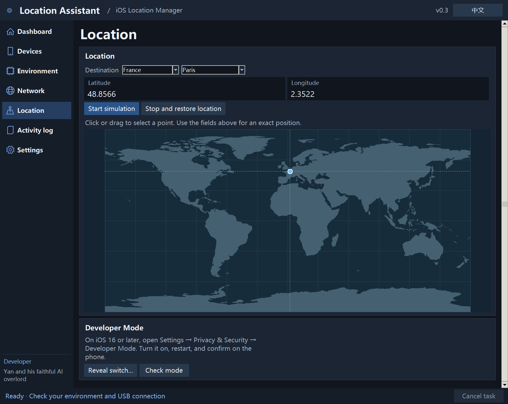

# Location Assistant · 虚拟定位助手

[中文](README.md) · English · [Test report](docs/TEST-REPORT.en.md)

> **Distribution notice**  
> The official GitHub repository is currently the only release channel for Location Assistant. Republishing or reselling this software is prohibited.

A Windows desktop tool for testing how your own iPhone app behaves in another city. Connect one iPhone by USB, choose a preset or drag a point on the offline map, then start the simulation. When you're done, send a clear command to the same phone.

## Try Paris

1. Download **ios-location-assistant-v0.3-windows-x64.zip** from the repository's Releases page. Extract it and open **虚拟定位助手.exe**. Click **English** in the top-right corner. The app remembers your choice.
2. Install Python with pip if it is missing. The desktop window opens on its own, but the phone backend needs external Python. The tested version is 3.14.7. Windows also needs the Apple Devices USB driver.
3. Connect and unlock one iPhone. Accept the trust prompt on the phone. Click **Check environment / USB**. If the backend is missing, choose **Install environment…** to create a private virtual environment and download pymobiledevice3 11.63.1. The app asks before installing.
4. On iOS 16 or later, enable Developer Mode in **Settings → Privacy & Security**, restart and confirm on the phone. Use **Check tunnel** to test the connection.
5. Open **Location** and select **France → Paris**. The fields should read **48.8566**, **2.3522**. Click or drag anywhere inside the map to pick a custom point. The fields update as you drag. The preview is a world overview, so enter degrees directly when you need a precise point.
6. Click **Start simulation**, keep USB connected, and request a fresh location in Maps or your test app. Click **Stop and restore location** when finished. Check the phone again. If the cable was disconnected, reconnect the original phone, unlock it and retry.

Switching languages keeps the current page, coordinates and device session. Moving the marker edits the next target. If a simulation is already running, restore the phone's location before starting a different one.

## iOS versions and USB

| Version | What to prepare |
| --- | --- |
| iOS 16 and earlier | The legacy USB developer service generally needs a matching Developer Disk Image. Versions before iOS 16 do not have a Developer Mode switch. |
| iOS 17.0–17.3 | Windows needs the upstream tunnel driver and a running administrator tunneld service. |
| iOS 17.4 and later | Supported devices can establish a userspace tunnel over USB. |

An iPhone 14 Pro running iOS 26.7.1 was used for USB detection, version reading and a read-only tunnel check in the previous release. The start, hold and restore sequence still needs an end-to-end check in Maps. Android phones need their own mock-location app; this release controls iPhones. [Test record](docs/TEST-REPORT.en.md) · [Upstream tunnel guide](https://github.com/doronz88/pymobiledevice3/blob/master/docs/guides/ios17-tunnels.md)

## Network and logs

Choosing Paris changes the simulation target. To check the computer's public IP and estimated country, open **Network** and approve a one-time request to ipapi.co. The phone uses its own network connection. **Launch VPN / proxy…** opens an existing client for you to configure.

If Windows cannot find the phone, first check the cable, the trust prompt and whether Apple Devices can see it. For a bug report, include the model, iOS version, button you clicked and the redacted activity log. Leave device identifiers and pairing files out of the report.

## Run from source

Use Python 3.14 with Tk installed and run `python main.py`, or double-click `launch.bat`. Run `build.bat` on Windows to create the executable in `dist`. Run `python -m unittest discover -s tests -v` from the project directory to run the automated checks.

Developer: Yan以及他忠实的AI大人. Device communication uses [pymobiledevice3](https://github.com/doronz88/pymobiledevice3). The offline land outlines come from [Natural Earth](https://www.naturalearthdata.com/).
