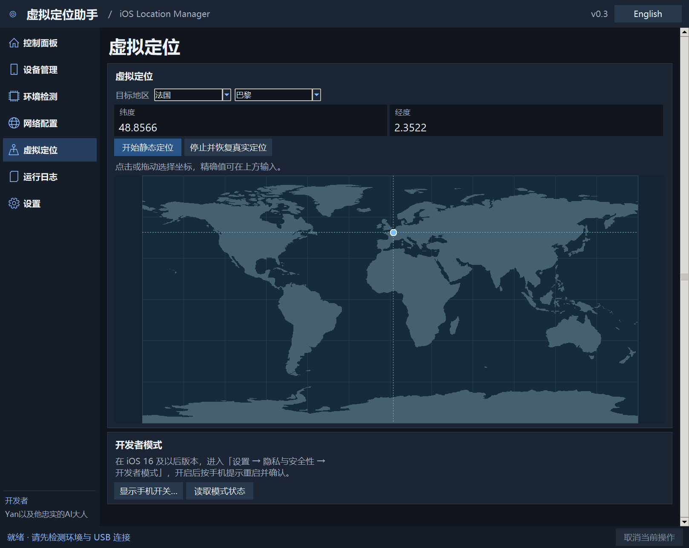

# 虚拟定位助手 0.3

中文 · [English](README.en.md) · [测试报告](docs/TEST-REPORT.md)

> **发布声明**  
> 虚拟定位助手目前仅通过 GitHub 官方仓库发布。禁止二次转载或转售本软件。

在 Windows 上用 USB 连一台自己的 iPhone，选一个城市，把坐标发给手机，测完再恢复。适合检查自己的 App 换个城市以后会显示什么。

这个工具起于两次命令行测试：一次东京，一次洛杉矶。洛杉矶的经度要填负数，每次换地点还要先结束上一条命令。现在把选坐标、保持连接和清除模拟放在了同一个窗口里。设备通信由 [pymobiledevice3](https://github.com/doronz88/pymobiledevice3) 完成。



## 拖动选点与语言切换

打开「虚拟定位」，在地图内点击或按住左键拖动，目标会切换成「自定义」，经纬度会跟着光标变化。需要精确到街道时，直接输入已知坐标。点「开始静态定位」才发送到手机。已开始一次定位时，先恢复，再启动新的目标。

右上角的 **English / 中文** 可以随时切换界面语言，并记住下次打开时的选择。切换时保留当前页面、坐标和设备会话。

## 跑一次洛杉矶测试

1. 从仓库右侧的 **Releases** 下载 `ios-location-assistant-v0.3-windows-x64.zip`，完整解压，双击里面的 **虚拟定位助手.exe**。窗口可以独立打开，连接手机还需要本机有 Python。本项目用的是 Python 3.14.7。
2. 用能传数据的 USB 线接上一台 iPhone，解锁，在手机上确认信任电脑。点击 **检测环境 / USB**。如果找不到 Python，在「设置」里选 `python.exe`。如果缺少 pymobiledevice3，点击 **安装隔离环境**，确认后程序会安装 11.63.1 版及所需依赖。
3. iOS 16 及以上需要打开开发者模式。进入手机的「设置 → 隐私与安全性 → 开发者模式」，按手机提示重启和确认。回到电脑，点击 **检测开发者隧道**。
4. 选「美国 → 洛杉矶」。纬度是 `34.0528`，经度是 `-118.2516`。点击 **开始静态定位**，再打开 iPhone 地图，点一下定位按钮，或在自己的 App 里重新请求位置。电脑上的预览点跟着输入框移动，实际效果请看手机。
5. 保持数据线连接，点击 **停止并恢复真实定位**，回到手机再取一次位置。如果中途拔过线，接回刚才那台手机，解锁后重试恢复。

## 哪些设备试过

目前有一台 **iPhone 14 Pro（iOS 26.7.1）** 的 USB 识别和开发者隧道实测记录。桌面版在 Windows 11 x64 上完成打包。这个版本还缺一次从界面开始、持续保持、最后在手机地图确认恢复的完整记录。

iOS 17.4 及以后走用户空间隧道。17.0–17.3 在 Windows 上需要先准备驱动，并手动启动管理员 `tunneld` 服务。iOS 16 及以前使用传统 USB 开发者服务，通常需要匹配的开发者镜像。旧版系统已检查命令选择，仍待对应真机验证。当前版本只控制 iPhone。[测试报告](docs/TEST-REPORT.md) · [上游隧道说明](https://github.com/doronz88/pymobiledevice3/blob/master/docs/guides/ios17-tunnels.md)

## 两个常见问题

**为什么地图里选了美国，IP 还是原来的？**  
城市选项只设置 GPS 坐标。「网络配置」查询的是电脑的公网出口，需要单次授权才会联系 ipapi.co。手机用哪个出口，取决于手机自己的网络。

**连上了线，软件还是找不到手机？**  
先看 Windows 上的 Apple Devices 能否识别这台手机，再检查数据线、解锁状态和手机上的信任提示。如果要反馈问题，可以从「运行日志」导出脱敏记录，附上系统版本、点击了哪个按钮和预期结果。设备标识、配对文件和公网 IP 都用不上。

## 从源码运行

安装带 Tk 的 Python 3.14，双击 `launch.bat`，也可以在仓库目录运行 `python main.py`。需要重新生成 EXE 时运行 `build.bat`，构建结果在 `dist`。自动检查命令如下。

```powershell
python -m unittest discover -s tests -v
```

开发者：Yan以及他忠实的AI大人  
设备通信使用 [pymobiledevice3](https://github.com/doronz88/pymobiledevice3)，离线底图使用 [Natural Earth](https://www.naturalearthdata.com/) 的陆地数据。
